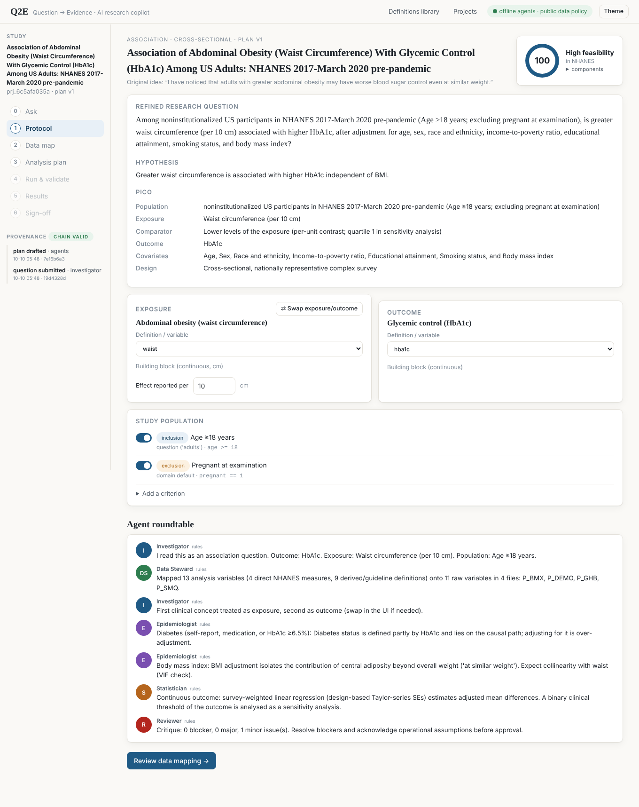
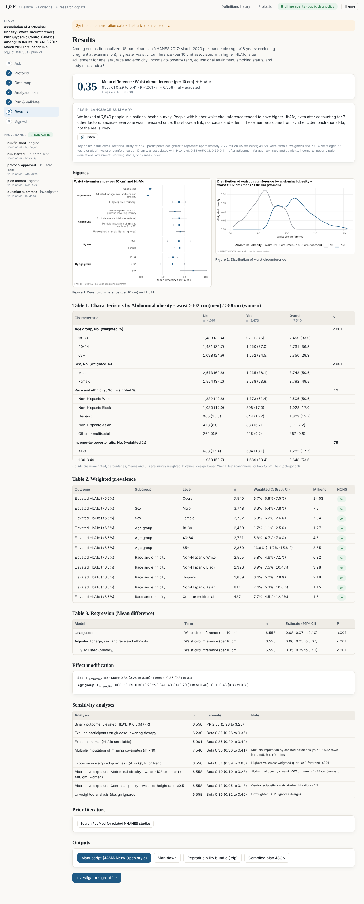
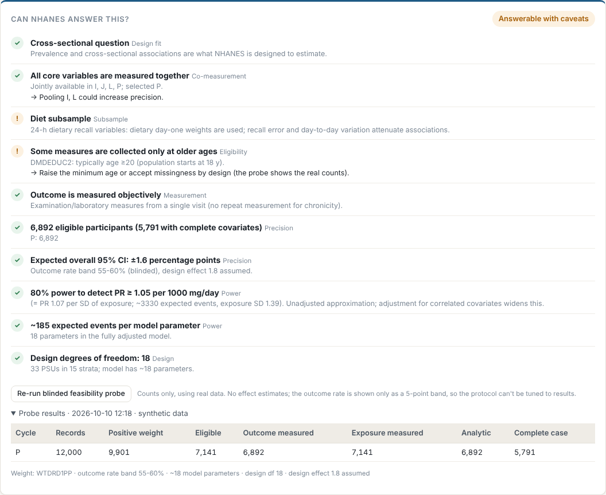

# Q2E — Question → Evidence

**An AI research copilot that turns a clinical observation into an approved, executed, validated and
reproducible survey-weighted study — written up in JAMA Network Open style.**

> *"Do a research study on the prevalence of functional iron deficiency."*
> → PICO protocol → NHANES variable map → statistical analysis plan → **investigator approval** →
> survey-weighted analysis in R → 20+ automated QC checks → comparison against the published estimate
> (Tawfik et al., *JAMA Netw Open* 2024) → manuscript, figures, reproducibility bundle → **investigator sign-off**.



Built for *Ops Unleashed — Challenge 4: AI Research Copilot (Research Services)*.

---

[](https://codespaces.new/ks007x/QuestionNHANES?quickstart=1)

## Use the app in your browser (no install)

Click **Open in GitHub Codespaces** above (or **Code -> Codespaces -> Create codespace on main**). The first start
takes ~3-5 minutes while R and Python packages install; after that the Q2E app opens in a new browser tab. If it
does not, open the **PORTS** tab at the bottom and click the globe icon next to port 8000. Type your research
question in the box on the first screen. Codespaces have internet access, so **CDC (download real data)** works.
Stop the codespace when done (github.com/codespaces) to save your free monthly hours.

## Why it's different

| Design choice | What it means |
|---|---|
| **Answers "can NHANES answer this?" first** | A static answerability check plus a blinded data probe (counts only) estimate feasibility and power before any protocol is approved. |
| **The AI proposes; rules check; a human approves** | Rule-based research agents always run (offline, deterministic). An optional LLM (Claude, Azure OpenAI, AWS Bedrock, any OpenAI-compatible endpoint, or a local Ollama model) adds interpretation and critique. Every LLM output is checked against the ontology and expression whitelist, and anything it invents must be approved by a person. |
| **No free-form generated code runs** | Analyses run in a versioned R engine (`survey` package). Derived variables and criteria use a **whitelisted expression language**: the syntax tree is checked and evaluated in an empty environment, so `system()`, file I/O and assignment cannot be reached even if an LLM wrote the expression. |
| **Guideline definitions are versioned and citable** | ASH 2026 iron deficiency, KDIGO 2026 CKD anemia/iron, Baveno VII **and VIII**, WHO 2020/2024, ESC heart failure, Tawfik 2024. Each records its source, verification status and every **operational assumption** needed to compute it in NHANES (e.g. "inflammation ≈ hsCRP >5 mg/L"). The investigator must acknowledge these. |
| **Approval is locked to a hash** | Approval binds to the SHA-256 of the exact plan. Any edit invalidates it. Sign-off binds the plan hash, the results hash and the investigator's name in a **hash-chained provenance ledger**. |
| **Replicates published estimates** | Definitions can carry literature benchmarks; the engine flags whether its estimate's CI overlaps the published one. |
| **Works with any open dataset** | Upload a CSV and its data dictionary. Q2E detects weight, strata and PSU columns, maps building blocks to your variables (BM25 matching plus clinical synonyms), drops what the dataset can't support, and asks you to confirm the mapping. |
| **Data never leaves the engine** | LLMs only see the question, the plan and dictionary metadata. Aggregate results are shared only if policy allows. `Q2E_DATA_POLICY=restricted` limits use to approved or local models. |

## Quick start

> **Not a programmer?** Follow **[START_HERE.md](START_HERE.md)**: install Python and R once, then double-click
> `Start-Q2E-Windows.bat` (Windows) or `Start-Q2E.command` (Mac). Q2E opens in your browser.

### Docker (everything included)
```bash
cp .env.example .env              # optional: add LLM / ElevenLabs keys
docker compose up --build         # → http://localhost:8000
```

### Local
Requirements: Python ≥ 3.10 and R ≥ 4.2.
```bash
pip install -r requirements-dev.txt
Rscript r/install_packages.R      # survey, jsonlite, haven, ggplot2, mice, mitools, yaml, testthat
make synth                        # synthetic NHANES-like files for the offline demo
python -m q2e serve               # → http://127.0.0.1:8000
```

### Data
* **Real NHANES**: put `.xpt` files in `data/nhanes/`, named as on CDC (`P_DEMO.xpt`, `P_FERTIN.xpt`, `DEMO_J.xpt`, …). Q2E looks in that folder first, then in its cache, then downloads from `wwwn.cdc.gov` (set `Q2E_ALLOW_DOWNLOAD=false` to turn downloads off).
* **Synthetic demo**: choose *Synthetic demo* as the data source. The files reproduce NHANES file and variable names, codes, the complex design and plausible correlations. Every output from them carries a **SYNTHETIC** watermark.
* **Verify the curated dictionary** against your files and export every variable label:
  `Rscript scripts/verify_nhanes_dictionary.R data/nhanes nhanes_full_dictionary.csv`

### Command line (headless)
```bash
python -m q2e study "Is higher liver stiffness associated with thrombocytopenia in US adults?" --source synthetic --out outputs/lsm
python -m q2e examples            # all five demo questions → manuscripts + bundles
```

## Run a study on real NHANES data from GitHub (no install)

1. Open the repository's **Actions** tab and pick **Run a study on real NHANES data**.
2. Click **Run workflow**, type a question (and cycles, default `P` = 2017-March 2020), then **Run workflow**.
3. GitHub's server downloads the public NHANES files directly from the CDC, runs the R analysis, and in ~10-20 minutes
   shows the manuscript on the run's summary page. The **Artifacts** section has `manuscript.html` and the
   reproducibility `bundle.zip` (with `reproduce.R` and the file checksums of the exact CDC files used).

The AI provider is forced to `offline` in this workflow, so no study content is sent to any external model. Downloaded
files are cached between runs; they are never committed to the repository.

## Multi-arm comparisons with defined controls

Ask "Toxoplasma vs Toxocara vs healthy controls for eosinophilia" (or "compare anemia in diabetes versus CKD versus
controls"). Q2E builds one exposure with mutually exclusive groups - *Healthy controls (reference) | Toxoplasma only |
Toxocara only | Both positive* - and reports each group vs control, every pair of groups, and a design-based overall
test. Controls are defined, not assumed: **negative for every group** or **healthy controls** (also free of conditions
that change the outcome and of major chronic disease, using only conditions measured in that cycle and never the
outcome itself). Because healthy controls inflate contrasts, the no-screening control group always runs as a
sensitivity analysis and the design audit flags it. Both choices are one click on the Plan page.

## Understanding broad questions (full CDC catalog)

- **13,152 NHANES variables, 1999-2023**, from the CDC variable lists (`knowledge/nhanes/catalog.csv`, rebuilt by the
  *Build NHANES variable catalog* GitHub workflow), including each variable's file name in every cycle
  (eosinophils: `LAB25` 1999-2000 ... `CBC_L` 2021-2023).
- **Automatic cycle choice**: questions go to the most recent cycle that measured the variables with usable weights
  (Toxocara/Toxoplasma -> 2011-2012), or leave the cycle buttons on *Auto* and pick your own.
- **Automatic subsample weights**: surplus-specimen and laboratory subsamples are analysed with their own weights
  (e.g. `WTSSTT2Y` for Toxocara/Toxoplasma 2011-2012; `WTPH2YR` phlebotomy weights in 2021-2023).
- **Umbrella terms**: "parasite" expands to the parasites NHANES measured (Toxocara, Toxoplasma; composite plus each
  one), with an honest note that stool ova and parasites, Strongyloides and malaria were never measured.
- **Precise catalog matching**: "hepatitis E" never matches hepatitis C; "B12 deficiency" picks serum B12, "dietary
  B12" the 24-hour recall; incidental words inside long questionnaire items are ignored.
- **Teach Q2E**: on the Map page, search the dictionary and click **Teach** to map a phrase to a variable. The mapping
  is recorded with the teacher's name and used for every future question on that server.

## Novelty, design audit and AI-tool integration

- **Novelty score** (next to feasibility on the protocol page): PubMed/MEDLINE count of NHANES papers already answering
  the same question (10 y, and last 3 y), the closest prior work, differentiation levers (newest cycle, 2025+ guideline
  definition, effect modification) and suggestions when the topic is crowded.
- **Design audit**: checks each plan against the criticisms made of EHR-network (TriNetX-style) studies - inappropriate
  comparator (users vs non-users / confounding by indication), code- or self-report-only and treatment-defined outcomes,
  circular outcomes, reverse causation (with an automatic "exclude diagnosed participants" sensitivity analysis),
  adjustment set, a priori rationale, hash-locked prespecification, executable methods, clinically trivial effects, and
  documented statistician sign-off. Shown on the Plan page and in the manuscript supplement.
- **Sponsor AI tools**: one governed tool set over REST (`/api/tools`) and MCP (`python -m q2e mcp`), with manifests for
  Azure OpenAI / AI Foundry, AWS Bedrock, ElevenLabs and MCP clients. AI cannot approve - see `docs/INTEGRATIONS.md`.

## Sample size, covariates, limitations and certainty of evidence

- **Novelty reflects the whole PICO**: every outcome x exposure/arm pair is searched separately (NHANES and any data),
  so a known pair (e.g. Toxocara and eosinophilia) lowers the score even when the full 3-way question is new; the
  summary shows the per-element breakdown. Each option in the follow-up chat shows its own novelty chip.
- **Sample size and power** (Plan page): alpha, power, target prevalence ratio, design effect and Bonferroni across
  arms are editable; group sizes come from the blinded probe; after the run the minimum detectable effect is
  recomputed from the design-based SEs (`GET /api/projects/{id}/power`).
- **Covariate suggestions**: confounders (add to the model) vs possible mediators (offered only as an
  "additionally adjusted" sensitivity analysis); variables that share items with the outcome/exposure are never offered
  (`GET /api/projects/{id}/covariates`, library in `knowledge/covariates.yaml`).
- **Methods summary, detected limitations and GRADE-informed certainty** (Results page, manuscript supplement,
  `appraisal.json` from the CLI): observational evidence starts Low and is rated down for risk of bias, inconsistency
  across sensitivity analyses, indirectness and imprecision (CI and power), and up for a large effect or a
  dose-response gradient. It is labelled as a single-study rating, because GRADE rates bodies of evidence
  (`GET /api/projects/{id}/appraisal`).

## Where next? Journals, conferences and funding

After a run, **Find journals, deadlines & funding** (Results page; also `where_next.md` in every CLI/GitHub run):
- **Journal match score** = 45% topical precedent (PubMed: share of NHANES papers on the same outcome/exposure in the
  last 5 years) + 35% scope fit + 20% design fit for cross-sectional survey analyses. Journals outside the curated list
  appear when PubMed shows they publish this topic.
- **Next abstract windows** for the society meetings that fit the study's domains, sorted by days remaining
  (typical months - each links to the official page to confirm).
- **Funding leads**: matching NIH institutes and mechanisms (R03/R21/K/F32), foundations, recently funded NIH projects
  on the topic (NIH RePORTER, re-checked for relevance), and open/forecasted NIH opportunities (Grants.gov).
- **Specific Aims seed** that turns the study result into preliminary data.

## The workflow (maps to the challenge stages)

Item-by-item check against the challenge brief, with evidence from a real-data run: [docs/CHALLENGE_CHECKLIST.md](docs/CHALLENGE_CHECKLIST.md).

| Stage | Q2E | Who decides |
|---|---|---|
| 1 Refine the question | **Investigator agent** parses population, exposure, comparator, outcome, covariates, inclusion and exclusion criteria, and the hypothesis. It handles guideline cues ("KDIGO 2026", "Baveno VIII", "ASH") and "at similar weight" style adjustments, and flags questions outside a cross-sectional design (incidence, mortality). | Edit any text, switch definitions, swap exposure and outcome |
| 2 Protocol | Title, refined question, hypothesis, PICO, design, limitations (including every operational assumption) | Acknowledge assumptions |
| 3 Map concepts → variables | **Data Steward** traces each analysis variable to NHANES files and variables per cycle, separates direct measures from derived variables, and checks availability by cycle. Includes a dictionary explorer. | Approve AI-proposed variables; map uploaded datasets |
| 4 Statistical analysis plan | **Statistician** picks the estimand, model family (quasi-Poisson PR / logistic OR / linear), adjustment sets, effect modifiers, missing-data approach (complete case plus MICE), and auto-generated sensitivity analyses. The **Epidemiologist** removes mediators and covariates that overlap the outcome or exposure definition. The **Reviewer** raises blocker, major and minor issues with one-click fixes. The feasibility score goes from 0 to 100. | Approve the plan (locked by hash) |
| 5 Execute | R engine: import, merge by SEQN, combine cycles with weight rescaling, recode non-response, derive variables, apply criteria as domain (subset) estimation, `svydesign`, Table 1, Korn-Graubard prevalences, `svyglm`, interactions, MI, E-values, figures | — |
| 6 Validate | 20+ checks: variable availability, synthetic-data guard, cycle overlap, weight choice and values, design df, sample size, events per parameter, missingness, value ranges, NCHS proportion standards, convergence, implausible estimates, parameters vs design df, collinearity (VIF), agreement across sensitivity analyses, literature benchmark, derivations | Override each failed check with a written reason |
| 7 Results | Headline estimate, replication check, plain-language summary (audio via ElevenLabs), figures, Table 1–3, sensitivity table, PubMed prior literature, JAMA-style manuscript (Key Points, structured abstract, Methods, Results, Discussion, supplement), reproducibility bundle | **Sign-off** with attestations |



## Concept coverage & "Can NHANES answer this?"
Questions are understood in four layers, falling through from one to the next:
1. ~90 curated clinical concepts.
2. ~135 curated NHANES variables.
3. The **full NHANES variable catalog**, which you build once with `scripts/build_nhanes_catalog.py` (from CDC or from your own `.xpt` files). It is searched with BM25 for any phrase the ontology doesn't cover.
4. A catalog of ~340 NHANES components (tables).

A list of things NHANES *cannot* answer (mortality, incidence, dementia diagnosis, sepsis/ICU, transplant, cancer stage, imaging, genetics) feeds the **answerability engine**. It checks design fit, coverage, whether all variables are measured in the **same cycles** (oscillometric and auscultatory blood pressure count as alternatives), subsamples and weights, age eligibility, and measurement type. A **blinded feasibility probe** then runs on the real data and returns counts and a 5-point outcome-rate band only, never an effect estimate. From these it computes the expected CI width, the minimum detectable prevalence ratio, events per parameter and the design df.
Details: [docs/ANSWERABILITY.md](docs/ANSWERABILITY.md).



## Statistical methods (R engine)
* Design-based inference with NHANES masked variance units: `svydesign(ids=~SDMVPSU, strata=~SDMVSTRA, weights=~WT, nest=TRUE)`, Taylor linearization, `survey.lonely.psu="adjust"`.
* **Automatic weight selection.** The most restrictive component among the variables used decides the weight: interview → MEC → fasting subsample (`WTINT*`, `WTMEC*`, `WTSAF*`). When cycles are combined, weights are rescaled by cycle length (3.2 years for the 2017–March 2020 pre-pandemic file). Combining the J and P files is blocked because they overlap.
* **Subpopulations** use `subset(design, …)` and never drop rows before the design is built.
* **Prevalence** uses `svyciprop(method="beta")` (Korn–Graubard CIs) and weighted totals (millions of people). Each estimate is checked against the **NCHS Data Presentation Standards for Proportions**: effective n, CI width, relative CI width and degrees of freedom.
* **Regression** uses `svyglm` with **quasi-Poisson (log link) → prevalence ratios** for binary outcomes (the default for cross-sectional data), quasi-binomial → odds ratios as a sensitivity analysis, and Gaussian for continuous outcomes. Wald inference uses the design degrees of freedom. Effects are reported per a clinically meaningful unit (e.g. per 10 cm of waist circumference, per 5 kPa of liver stiffness).
* Reported alongside: crude, demographic-adjusted and fully adjusted models; product-term Wald F tests plus stratified estimates; weighted exposure quartiles with a P for trend; MICE multiple imputation embedded back into the full design (Rubin's rules); unweighted contrast; alternative definitions, exposures and exclusions; E-values.

## Guideline definitions library (`knowledge/definitions/`)

| Definition | Source | Status |
|---|---|---|
| Iron deficiency: ferritin ≤30 (≤50 for pregnancy with anemia; <100 or TSAT <20% with inflammation) | ASH 2026, Powers et al., *Blood Adv* (doi 10.1182/bloodadvances.2025015950) | secondary-source |
| Absolute ID: ferritin <30; functional ID: ferritin ≥30 and TSAT <20% (+ benchmarks 14% and 15%) | Tawfik et al., *JAMA Netw Open* 2024;7(9):e2433126 | secondary-source |
| CKD: systemic ID (TSAT <20% and ferritin <100), iron-restricted erythropoiesis, iron-therapy eligibility (Rec 2.3) | KDIGO 2026 Anemia in CKD | secondary-source |
| CKD iron trial (TSAT ≤30%, ferritin ≤500) | KDIGO 2012 | verified |
| cACLD rule of five; CSPH rule-in/rule-out (LSM ≥25 kPa only when BMI <30; obese → model required) | Baveno VIII 2026 (doi 10.1016/j.jhep.2026.07.030) | secondary-source |
| cACLD ≥10 kPa; CSPH rule-out ≤15 kPa and platelets ≥150 / rule-in ≥25 kPa | Baveno VII 2022 | verified |
| ESC heart-failure ID; WHO 2020 ferritin; WHO anemia; ADA diabetes; ATP III waist; CKD (eGFR/UACR) | various | verified |

*secondary-source* means the thresholds came from society press releases or summaries of the primary
publication. Confirm them against the full text before submission; Q2E shows this as a reviewer item. New guidelines
can be **imported from pasted text** by an LLM curator. They are stored as *proposed* and cannot run until an
investigator approves them. **Guideline watch** queries PubMed for publications newer than each library entry.

## AI providers & integrations
`Q2E_LLM_PROVIDER = offline | anthropic | azure_openai | bedrock | openai | ollama`. See `.env.example`.

* **Azure OpenAI** and **AWS Bedrock** suit enterprise tenants covered by a BAA or DUA. Add them to `Q2E_APPROVED_PROVIDERS` for restricted data.
* **Ollama** keeps the model on your machine.
* **ElevenLabs**: dictate the research idea (Scribe speech-to-text) and listen to the plain-language briefing (text-to-speech). Without a key, the browser's speech APIs are used.
* **PubMed E-utilities**: prior NHANES literature and guideline update watch.
* Other AI platforms can be connected through the OpenAI-compatible provider (`OPENAI_BASE_URL`), as long as they expose that API.

## Human oversight (deliverable 6)
See [docs/HUMAN_OVERSIGHT.md](docs/HUMAN_OVERSIGHT.md). In short: question framing, case definitions and their
operational assumptions, confounder structure, plan approval (by hash), QC overrides, interpretation and sign-off
stay with the investigator. Data governance sits with the institution.

## Reproducibility
Each run produces a bundle containing `compiled_plan.json`, `study_plan.json`, `results/`, the R engine source,
`provenance.json` (hash-chained ledger) and `reproduce.R`. Running the script re-executes the analysis and checks
that the primary estimate matches; this was verified for the bundled example. For synthetic runs the data are
included in the bundle. For NHANES runs the file MD5 checksums are recorded.

## Tests
```bash
make test        # R testthat (expression safety, cases(), CKD-EPI) + 46 pytest tests incl. end-to-end R runs
```
CI (`.github/workflows/ci.yml`) installs R and Python, generates synthetic data, runs all tests and every example study, and uploads the manuscripts.

## Repository layout
```
q2e/            Python orchestrator: agents, planner, compiler, LLM providers, privacy, runner, report, server
r/engine/       R biostatistics engine (run_pipeline.R + R/: dsl, io, design, describe, models, validate, figures)
r/synth/        synthetic NHANES-like data generator
knowledge/      NHANES cycles + curated dictionary, building blocks, guideline definitions, concept ontology, examples
web/            single-page UI (vanilla JS, no build step)
scripts/        verify_nhanes_dictionary.R
docs/           architecture, oversight, validation, governance, demo script, example manuscripts, screenshots
tests/          pytest suite (r/tests for testthat)
```

## Example outputs (synthetic data)
`docs/examples/`: manuscripts for all five demo questions and one reproducibility bundle.

## Honest limitations
* The curated NHANES dictionary (≈135 variables) was written from domain knowledge. Run `scripts/verify_nhanes_dictionary.R` against the official files. The engine also fails loudly if a variable is missing.
* Definitions marked *secondary-source* still need to be checked against the primary guideline text.
* Example outputs in this repo come from **synthetic** data. They demonstrate the pipeline, not population estimates.
* NHANES is cross-sectional. Q2E deliberately refuses causal language and flags incidence or mortality questions as out of scope; the linked mortality files are not integrated.
* This is research software, not a medical device. Outputs need expert review.

MIT License.
