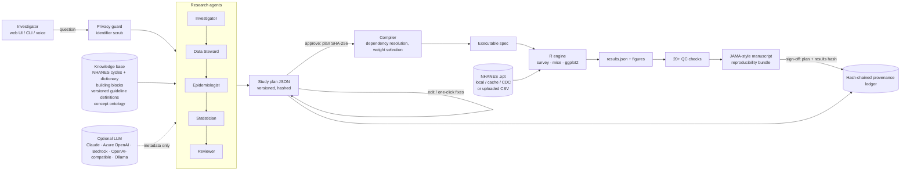

# Architecture



## Components
| Layer | Files | Notes |
|---|---|---|
| Knowledge | `knowledge/` | YAML/CSV, human-readable and versioned in git. *Measure* building blocks map onto raw variables (NHANES expression, or a dataset column for uploaded data); *derived* blocks and guideline definitions are dataset-agnostic expressions. |
| Agents | `q2e/planner.py` (rules), `q2e/agents.py` (LLM merge) | Rules always run; the LLM can only choose ontology IDs, propose expressions that pass the whitelist, or add critique and narrative. |
| Plan editing | `planner.apply_fix` | Every UI edit is an operation (`set`, `remove_covariate`, `set_definition`, `swap_roles`, `acknowledge`, …), logged and versioned. |
| Compiler | `q2e/compiler.py` | Resolves variables in topological order, scales the exposure, collects raw variables, files and cycles, picks the weight level, and computes the plan hash. |
| Engine | `r/engine/` | `dsl.R` safe expressions · `io.R` loading and merging · `design.R` flow and design · `describe.R` Table 1 and prevalence · `models.R` GLMs, MI, E-values · `validate.R` QC · `figures.R`. |
| Runner | `q2e/runner.py` | Background `Rscript` process; refuses to run plans that are unapproved or have blockers. |
| Reporting | `q2e/report.py` | Key Points, structured abstract, Methods (data source, population flow, definitions with citations, covariates, statistical analysis, AI-use statement), Results, tables, figures, Discussion, supplement. |
| Store | `q2e/store.py` | File-based projects, plan versions and a hash-chained event ledger (`verify_chain`). |
| API/UI | `q2e/server.py`, `web/` | FastAPI and a vanilla-JS single-page app. |

## The expression language
R syntax limited to: `+ - * / ^`, comparisons, `& | !`, `%in%`, `c()`, `ifelse()`, `coalesce()`, `any_of()`,
`all_of()`, `cases(cond, "label", …, .default=)`, `pmin()`, `pmax()`, `log()`, `log10()`, `exp()`, `sqrt()`,
`abs()`, `is.na()`, `round()`. Validation happens twice: in Python (tokenizer) and in R (a walk of the parsed syntax
tree). Evaluation runs in `new.env(parent = emptyenv())`.

Example: Baveno VIII CSPH
```r
cases(lsm <= 15 & plt >= 150, "CSPH ruled out",
      lsm >= 25 & bmi < 30,   "CSPH ruled in",
      lsm >= 25 & bmi >= 30,  "Model-based assessment required (obese)",
      .default = "Grey zone")
```
